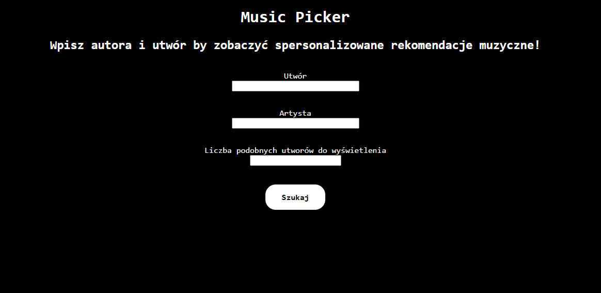
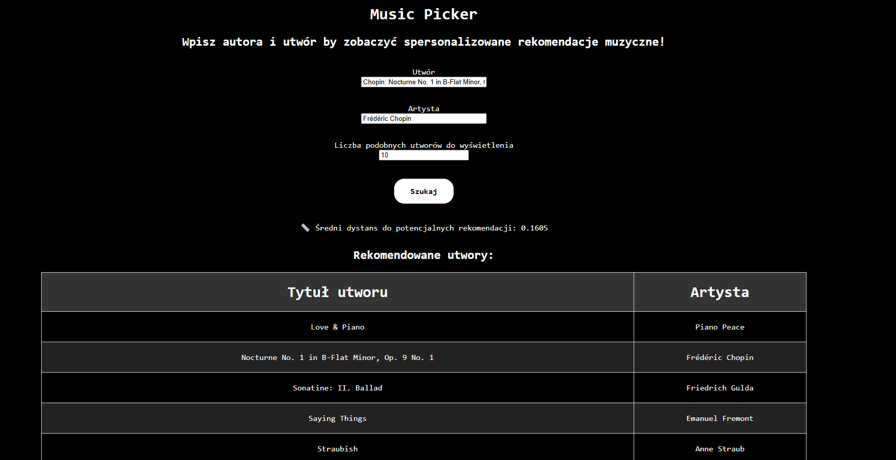

# 🎵 Music Picker

A simple music recommendation system to help you discover new songs! 🎧

This project uses a K-Nearest Neighbors (KNN) algorithm to recommend music based on a dataset of songs. The web interface allows you to search for a song and get a list of similar tracks.

<div align="center">


</div>

---

> Full documentation is available in [dokumentacja.pdf](./dokumentacja.pdf).

---

## 🚀 Getting Started

### Prerequisites

Make sure you have Python 3.x installed on your system.

### Installation & Running

1.  Clone the repository to your local machine.
2.  Install the required packages using pip:
    ```sh
    pip install -r requirements.txt
    ```
3.  Run the main application:
    ```sh
    python app.py
    ```
4.  Open your web browser and navigate to `http://127.0.0.1:5000` to use the app.

## 📂 Project Structure

```
.
├── recomender_system/    # Core recommendation logic
│   ├── KNN.py
│   ├── data_cleaning.py
│   └── search_engine.py
├── static/               # CSS styles
├── templates/            # HTML templates
├── app.py                # Main Flask application
├── main.py               # Main script
└── requirements.txt      # Python dependencies
```

## ✍️ Authors

-   **Piotr** - [xPietrUx](https://github.com/xPietrUx)
-   **Martyna** - [mszandala](https://github.com/mszandala)
